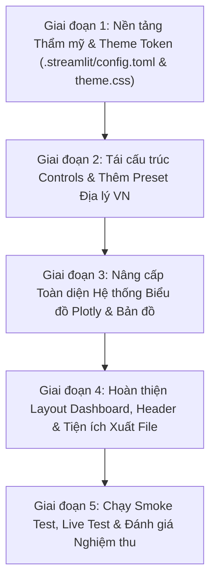

# KẾ HOẠCH NÂNG CẤP TOÀN DIỆN GIAO DIỆN (FRONTEND)
## HỆ THỐNG THU THẬP & PHÂN TÍCH KHÍ TƯỢNG ERA5 (ECMWF COPERNICUS)

---

> **Mã kế hoạch:** `FE-UPGRADE-ERA5-2026`  
> **Phạm vi tác động:** Chỉ chỉnh sửa giao diện Frontend (`frontend/`, `.streamlit/`), **hoàn toàn không thay đổi Backend, CSDL SQLite, CDS API logic hay quy chuẩn tính toán**.  
> **Ngôn ngữ triển khai:** 100% Python (`Streamlit`, `Plotly`, HTML/CSS tùy biến qua Python wrapper).  
> **Mục tiêu:** Chuyển đổi giao diện nguyên bản dạng mẫu thử (prototype) thành Trạm Phân tích Khí hậu Chuyên sâu (Meteorological Climate Intelligence Station) chuẩn mực khoa học, sắc nét, trực quan và tiện dụng.

---

## MỤC LỤC
1. [BỐI CẢNH DỰ ÁN & ĐÁNH GIÁ HIỆN TRẠNG](#1-bối-cảnh-dự-án--đánh-giá-hiện-trạng)
2. [TRIẾT LÝ THIẾT KẾ & ĐỊNH HƯỚNG BẢN SẮC](#2-triết-lý-thiết-kế--định-hướng-bản-sắc)
3. [HỆ THỐNG DESIGN TOKENS (BẢNG MÀU & TYPOGRAPHY)](#3-hệ-thống-design-tokens-bảng-màu--typography)
4. [BỐ CỤC KHÔNG GIAN & BẢN VẼ ASCII WIREFRAMES](#4-bố-cục-không-gian--bản-vẽ-ascii-wireframes)
5. [CHI TIẾT NÂNG CẤP TỪNG THÀNH PHẦN GIAO DIỆN](#5-chi-tiết-nâng-cấp-từng-thành-phần-giao-diện)
6. [KIẾN TRÚC MÃ NGUỒN FRONTEND MỚI](#6-kiến-trúc-mã-nguồn-frontend-mới)
7. [BẢO TOÀN GIAO ƯỚC KỸ THUẬT (CONTRACT PRESERVATION)](#7-bảo-toàn-giao-ước-kỹ-thuật-contract-preservation)
8. [LỘ TRÌNH THỰC HIỆN THEO TỪNG GIAI ĐOẠN](#8-lộ-trình-thực-hiện-theo-từng-giai-đoạn)

---

## 1. BỐI CẢNH DỰ ÁN & ĐÁNH GIÁ HIỆN TRẠNG

### 1.1 Bản chất nghiệp vụ & Đối tượng người dùng
- **Đề tài:** Xây dựng ứng dụng thu thập dữ liệu khí tượng toàn cầu ERA5, trực quan hóa chuỗi thời gian thực và tích hợp AI Agent phân tích dữ liệu (Tham chiếu: Bài giảng TS. Nguyễn Thị Tuyết Nam).
- **Đối tượng sử dụng:** Giảng viên chấm seminar, nhà nghiên cứu khí tượng, sinh viên chuyên ngành và AI Agent khai thác dữ liệu qua màn hình quan sát.
- **Dữ liệu cốt lõi:** Chuỗi thời gian giờ/ngày/tháng/năm của 7 biến khí hậu chuẩn mực (Nhiệt độ 2m, Điểm sương, Lượng mưa, Tốc độ gió, Hướng gió, Thành phần vector gió u/v, Bức xạ mặt trời), quy chuẩn giờ địa phương **Việt Nam (UTC+7)**.

### 1.2 Nhược điểm của giao diện hiện tại
1. **Thiếu bản sắc thị giác (Visual Identity):**
   - Đang chạy theme Streamlit mặc định (nền trắng/xám phổ thông, thanh đỏ mặc định, font chữ generic).
   - Chưa có file cấu hình `.streamlit/config.toml` riêng.
2. **Trải nghiệm nhập liệu (UX Controls) còn thô:**
   - Tọa độ địa lý bắt buộc người dùng gõ thủ công vĩ độ/kinh độ (`10.8231`, `106.6297`), thiếu hoàn toàn bộ chọn nhanh (presets) các thành phố/tỉnh thành trọng điểm tại Việt Nam.
   - Các bộ điều khiển mốc nền (baseline) và so sánh (compare) xếp chồng dài ở sidebar gây loãng sự chú ý.
   - Chưa có nút reset nhanh hoặc các phím tắt chọn khoảng thời gian phổ biến (7 ngày qua, 30 ngày qua, Mùa mưa, Mùa khô).
3. **Hiển thị số liệu (Metrics & KPI) đơn điệu:**
   - Các thẻ `st.metric` dùng giao diện xám mặc định, thiếu phân cấp thị giác theo đặc tính biến (Nhiệt độ thì cần dải ấm/nóng, mưa cần sắc thái nước biển, gió cần vector hướng).
4. **Biểu đồ Plotly chưa đồng bộ thẩm mỹ khoa học:**
   - Biểu đồ dùng palette màu cơ bản, biên lề trắng thô, chưa có giao diện tối giản tinh tế (minimalist scientific gridline).
   - Bản đồ tọa độ dùng `scattergeo` mặc định với độ phân giải thấp, đơn độc một chấm điểm, chưa phản ánh được bối cảnh địa lý Việt Nam.
5. **Khu vực đồng bộ & Tác vụ tải dữ liệu (Live Sync & Jobs):**
   - Đoạn điều khiển theo dõi thời gian thực (Live Updates) đang bị comment tạm thời ở dòng 54-60 trong `dashboard.py`. Cần được khôi phục và thiết kế lại thành trạm giám sát trạng thái (Telemetry Bar) gọn gàng, trực quan.

---

## 2. TRIẾT LÝ THIẾT KẾ & ĐỊNH HƯỚNG BẢN SẮC

### 2.1 Định vị thẩm mỹ: "Trạm Quan trắc Khí quyển Sâu" (Atmospheric Deep Station)
- Giao diện lấy cảm hứng từ các trạm khí tượng thủy văn hiện đại của Châu Âu (ECMWF) và NASA Earth Observatory: **nghiêm cẩn, độ tương phản dữ liệu cao, ưu tiên tính trung thực của các trị số đo đạc**.
- **Tiêu chuẩn "Không Template Rập Khuôn":**
  - **Không** sử dụng phong cách màu kem ấm/terracotta quen thuộc của AI mặc định.
  - **Không** dùng card bo góc đồng loạt đổ bóng mờ nhạt (SaaS-card kit cliché).
  - **Không** viết hoa toàn bộ nhãn (no ALL-CAPS spam), không dùng icon trang trí thừa thãi.
  - Mọi đường kẻ, đường viền và khối dữ liệu đều mang chức năng phân nhóm thông tin logic (structural clarity).

### 2.2 Tiêu chí vàng:
1. **Dữ liệu là nhân vật chính (Data-First):** Số liệu đo đạc (nhiệt độ, lượng mưa, tốc độ) hiển thị với font monospace chính xác, tương phản cao, dễ đọc trong mọi điều kiện ánh sáng.
2. **Ngôn ngữ thuần Việt chuẩn mực:** Sử dụng thuật ngữ khí tượng học chính xác (`Độ lệch chuẩn`, `Bức xạ tích lũy MJ/m²`, `Điểm sương °C`, `Múi giờ UTC+7`).
3. **Phản hồi tương tác tinh tế:** Trạng thái tải dữ liệu (loading/caching) có hiệu ứng chuyển trạng thái mượt mà, thông báo lỗi chỉ rõ nguyên nhân và hướng xử lý.

---

## 3. HỆ THỐNG DESIGN TOKENS (BẢNG MÀU & TYPOGRAPHY)

### 3.1 Bảng màu đặc thù (Atmospheric Color Palette)
Hệ thống sử dụng bảng màu 6 token nền tảng lấy cảm hứng từ các tầng khí quyển và đại dương:

| Token Name | Mã Hex | Vai trò trong giao diện | Ý nghĩa vật lý |
|---|---|---|---|
| `--color-deep-atmosphere` | `#0B1320` | Nền chính (Canvas Background) | Khoảng không vũ trụ & ban đêm tầng bình lưu |
| `--color-troposphere-surface`| `#142032` | Nền khối thẻ (Surface Card / Container) | Tầng đối lưu, độ sâu quan trắc |
| `--color-barometric-border` | `#23354E` | Đường viền, vách ngăn (Hairline Borders) | Đường đẳng áp, ranh giới phân tách thông tin |
| `--color-ion-cyan` | `#00D2FF` | Điểm nhấn chính (Primary Accent / Focus) | Dòng xoáy gió, khí quyển năng động |
| `--color-solar-amber` | `#FFB020` | Điểm nhấn thứ cấp (Solar / Warning Accent)| Bức xạ mặt trời, cảnh báo biên độ nhiệt |
| `--color-text-primary` | `#F1F5F9` | Văn bản chính (Primary Typography) | Trắng băng thanh khiết, tương phản cao |
| `--color-text-secondary` | `#94A3B8` | Chú thích & Nhãn phụ (Muted Metadata) | Xám bạc quan trắc |

#### Màu sắc ngữ nghĩa chuyên ngành Khí tượng:
- **Dải Nhiệt độ (Thermal diverging):** `#3B82F6` (Lạnh / < 20°C) $\rightarrow$ `#10B981` (Dịu / 20–28°C) $\rightarrow$ `#F59E0B` (Ấm / 28–34°C) $\rightarrow$ `#EF4444` (Nắng nóng / > 35°C).
- **Lượng mưa (Precipitation):** Gradient xanh biển sâu `#0284C7` kết hợp thanh bar trong suốt.
- **Vector gió (Wind Vectors):** Sắc xanh Cyan băng giá `#38BDF8` với la bàn phân bố góc 8 hướng.

### 3.2 Typography Tokens
- **Font giao diện chung (Body & Headings):** `Inter`, `-apple-system`, `BlinkMacSystemFont`, `sans-serif`.
  - Trọng số nét: Regular (400) cho nội dung, Medium (500) cho nhãn trường, Semi-bold (600) cho tiêu đề khối.
  - Quy tắc: Luôn dùng Sentence case, cấm viết hoa toàn bộ thẻ label.
- **Font số liệu khí quyển (Data & Telemetry):** `'JetBrains Mono'`, `'Fira Code'`, `'Consolas'`, `monospace`.
  - Áp dụng bắt buộc cho: Tọa độ địa lý (`10.8231°N, 106.6297°E`), Dấu thời gian (`2025-02-01 14:00 UTC+7`), Trị số đo (`32.4 °C`, `12.5 mm`, `4.2 m/s`), Bảng thống kê.

---

## 4. BỐ CỤC KHÔNG GIAN & BẢN VẼ ASCII WIREFRAMES

### 4.1 Kiến trúc tổng thể (Global Grid Layout)
```text
+---------------------------------------------------------------------------------------------------+
|  [LOGO/ICON] TRẠM PHÂN TÍCH KHÍ TƯỢNG ERA5  |  TOẠ ĐỘ: 10.82°N, 106.63°E  |  MÚI GIỜ: UTC+7 (VN)   |
|  STATUS: ● KẾT NỐI API BÌNH THƯỜNG         |  BỘ LỌC ĐANG CHỌN: NHIỆT ĐỘ 2M | ĐỒNG BỘ: ĐÃ CẬP NHẬT |
+---------------------------------------------------------------------------------------------------+
| SIDEBAR (TRÁI: 280px)           | VÙNG LÀM VIỆC CHÍNH (MAIN WORKSPACE: TỰ CO GIÃN)                |
|                                 |                                                                 |
| [1] VỊ TRÍ & TỈNH THÀNH VN      | [TAB 1: TỔNG QUAN]  [TAB 2: CHUỖI GIỜ]  [TAB 3: BẢN ĐỒ]  [TAB 4]  |
|   - Chọn nhanh: [TP.HCM v]      | +-------------------------------------------------------------+ |
|   - Vĩ độ: 10.8231              | | BANNER TỔNG HỢP: 5 THẺ CHỈ SỐ METEOROLOGICAL KPI            | |
|   - Kinh độ: 106.6297           | | [TRUNG BÌNH]   [CỰC TIỂU]   [CỰC ĐẠI]   [ĐỘ LỆCH]   [SỐ GIỜ]  | |
|                                 | |   27.8 °C        23.1 °C     34.5 °C     ±2.4 °C     48 giờ   | |
| [2] BIẾN KHÍ HẬU & CHU KỲ       | +-------------------------------------------------------------+ |
|   - Biến: [Nhiệt độ 2m v]       | +-------------------------------+ +-------------------------+ | |
|   - Chu kỳ: [Theo ngày v]       | | KHỐI XU HƯỚNG CHÍNH (TREND)   | | KHỐI SO SÁNH ĐỐI CHỨNG    | | |
|   - Tổng hợp: [Trung bình v]    | |   Chiều hướng: ▲ Tăng dần     | |   Giai đoạn A vs B:       | | |
|                                 | |   Hệ số dốc:   +0.0412 °C/h   | |   Chênh lệch: +1.25 °C    | | |
| [3] THỜI GIAN KHẢO SÁT          | +-------------------------------+ +-------------------------+ | |
|   - Bắt đầu: [2025-01-01]       |                                                                 |
|   - Kết thúc: [2025-01-02]      | +-------------------------------------------------------------+ |
|   - Preset: [48h qua] [7 ngày]  | | BIỂU ĐỒ CHÍNH & VÙNG QUAN TRẮC (INTERACTIVE PLOT CANVAS)    | |
|                                 | | ~~~~~~~~~~/\~~~~~~~~~~~/\~~~~~~~~~~~~~ (Plotly Graph)       | |
| [4] ĐỒNG BỘ & MỐC NỀN (Thu gọn) | +-------------------------------------------------------------+ |
|   > Mốc nền khảo sát (Baseline) |                                                                 |
|   > Tự động đồng bộ CDS         |                                                                 |
+---------------------------------+-----------------------------------------------------------------+
```

### 4.2 Chi tiết wireframe Tab 2: Chuỗi thời gian & Biểu đồ bất thường
```text
+---------------------------------------------------------------------------------------------------+
| TAB 2: CHUỖI THỜI GIAN & PHÂN TÍCH BIẾN ĐỘNG                                                      |
|                                                                                                   |
| [ Bộ công cụ biểu đồ:  (o) Dải cực trị Min-Max   [x] Mốc chuẩn trung bình   [x] Đường xu hướng ]  |
| +-----------------------------------------------------------------------------------------------+ |
| |                                                                                               | |
| |   35|                                                     /\                                  | |
| |     |                                 /\                 /  \      /\                         | |
| |   25|   /\                           /  \               /    \    /  \                        | |
| |     |  /  \       /\                /    \-------------/------\--/----\                       | |
| |   15| /    \-----/--\--------------/-----------------------------------                       | |
| |      00h   06h   12h   18h       00h   06h   12h   18h       00h   06h   (UTC+7 Giờ VN)       | |
| +-----------------------------------------------------------------------------------------------+ |
|                                                                                                   |
| +-----------------------------------------------------------------------------------------------+ |
| | ĐỘ LỆCH SO VỚI MỐC NỀN (ANOMALY DETECTOR - BASELINE: 2024-12-30 ĐẾN 2024-12-31)               | |
| |   +3°C |       [+2.1]             [+1.8]                                                      | |
| |    0°C |---------|------------------|------------------|-------------------|                  | |
| |   -3°C |                            [-1.2]             [-2.4]                                 | |
| +-----------------------------------------------------------------------------------------------+ |
|                                                                                                   |
| +-----------------------------------------------------------------------------------------------+ |
| | MA TRẬN NHIỆT THÁNG VÀ NĂM (HEATMAP DISTRIBUTION)                                             | |
| |         T1   T2   T3   T4   T5   T6   T7   T8   T9  T10  T11  T12                             | |
| |   2024 [24] [26] [29] [31] [32] [30] [29] [29] [28] [27] [26] [25]                            | |
| |   2025 [25] [27] [29] [32] [..] [..] [..] [..] [..] [..] [..] [..]                            | |
| +-----------------------------------------------------------------------------------------------+ |
+---------------------------------------------------------------------------------------------------+
```

---

## 5. CHI TIẾT NÂNG CẤP TỪNG THÀNH PHẦN GIAO DIỆN

### 5.1 Thanh tiêu đề và Trạng thái Trạm quan trắc (Station Telemetry Header)
- Thay thế tiêu đề mặc định bằng khối Header dạng dải thông số khoa học:
  - **Tên trạm / Đồ án:** "HỆ THỐNG QUAN TRẮC & TÁI PHÂN TÍCH KHÍ TƯỢNG ERA5".
  - **Badge Tọa độ trực tiếp:** Hiển thị vĩ độ, kinh độ kèm tên địa danh nhận diện (ví dụ: `10.82°N, 106.63°E (Khu vực TP. Hồ Chí Minh)`).
  - **Pill Trạng thái kết nối API:** Xanh lục khi hoạt động bình thường, Hổ phách khi có độ trễ, Đỏ khi mất kết nối.
  - **Quy chuẩn hiển thị:** Gắn nhãn múi giờ `UTC+7` và đơn vị đo tương ứng với biến đang chọn.

### 5.2 Nâng cấp Thanh điều khiển Sidebar (Intelligent Controls Panel)
- **Bổ sung Bộ chọn nhanh Tỉnh/Thành phố Việt Nam (Geo-Presets):**
  - Cung cấp dropdown chọn sẵn: TP. Hồ Chí Minh (`10.8231, 106.6297`), Hà Nội (`21.0285, 105.8542`), Đà Nẵng (`16.0544, 108.2022`), Cần Thơ (`10.0452, 105.7469`), Hải Phòng (`20.8449, 106.6881`), Sa Pa (`22.3364, 103.8438`), Trường Sa (`8.6444, 111.9189`).
  - Khi chọn tỉnh thành, 2 ô số vĩ độ/kinh độ tự động cập nhật mượt mà; người dùng vẫn tự do sửa tọa độ chi tiết từng 0.01 độ.
- **Tối ưu hóa Chọn khoảng thời gian:**
  - Nút bấm nhanh (Quick pills): `Hôm qua`, `48 giờ qua`, `7 ngày gần nhất`, `Tháng hiện tại`.
  - Tách bạch rõ ràng phần "Mốc nền" (Baseline) và "Giai đoạn so sánh" (Period Comparison) thành các khối xếp mở (Expanders) gọn gàng, tránh cuộn trang quá dài.
- **Khu vực Đồng bộ & Tự động theo dõi (Live Sync Monitoring):**
  - Tích hợp công tắc theo dõi (`st.toggle`) và tiến trình đồng bộ vào card giám sát riêng ở chân sidebar, có biểu tượng nhịp đập (pulse indicator) khi đang đồng bộ nền.

### 5.3 Nâng cấp Hệ thống Biểu đồ Plotly (Scientific Plotly Theme)
- Viết module cấu hình theme Plotly dùng chung (`apply_scientific_theme`):
  - **Màu nền:** Trong suốt (`rgba(0,0,0,0)`) hoặc hòa lẫn với nền container.
  - **Đường lưới (Gridlines):** Nét đứt siêu mảnh màu `#1E3147`, giảm thiểu ô nhiễm thị giác.
  - **Hover Tooltip:** Định dạng thẻ đo đạc chính xác với font monospace: Ngày giờ VN rõ ràng, tên biến và giá trị kèm đơn vị đo chuẩn.
  - **Phân loại đặc thù cho từng biến:**
    - *Nhiệt độ:* Đường cong mượt kèm vùng tô mờ cực tiểu – cực đại (min/max fill band).
    - *Lượng mưa & Bức xạ:* Biểu đồ cột (Bar chart) sắc sảo với độ rộng tối ưu.
    - *Gió:* Biểu đồ vector hoặc la bàn hoa gió (Wind Rose) hiển thị hướng góc theo độ tròn và tốc độ gió.
    - *Độ lệch (Anomaly):* Cột phân kỳ 2 màu đỏ (dương) / xanh (âm) quanh trục số 0.

### 5.4 Bản đồ Địa lý Khí quyển (Spatial Cartography)
- Nâng cấp `map_figure`:
  - Thay thế bản đồ thô bằng giao diện tương tác cao với đường bờ biển Việt Nam chi tiết, ranh giới tỉnh và quần đảo Hoàng Sa, Trường Sa.
  - Thêm thẻ hiển thị tọa độ góc (Coordinates HUD card) đè lên góc bản đồ, hiển thị giá trị khí tượng tại điểm đo theo thời gian thực.
  - Thêm vòng tròn bán kính ảnh hưởng lưới lưới trạm (ERA5 grid resolution 0.25° $\approx$ 28-31 km).

### 5.5 Trung tâm Xuất dữ liệu & Quản lý Tác vụ (Export & Task Station)
- Thêm tiện ích xuất dữ liệu 1 chạm (One-click Export):
  - Tải bảng số liệu đang lọc dưới dạng `CSV` hoặc `JSON` chuẩn mực (phù hợp nộp đồ án hoặc nạp vào AI Agent phân tích).
- Giao diện bảng tác vụ nền CDS:
  - Bảng tiến trình tải dữ liệu hiển thị dạng thanh tiến độ (Progress Bar trực quan), huy hiệu trạng thái có màu (Xanh: Hoàn tất, Vàng: Đang xử lý, Đỏ: Lỗi kèm lý do rõ ràng).

---

## 6. KIẾN TRÚC MÃ NGUỒN FRONTEND MỚI

Toàn bộ kế hoạch chỉ phân bố trong thư mục `frontend/` và `.streamlit/`, giữ nguyên vẹn 100% các file bên ngoài:

```text
cao-va-phan-tich-era5/
├── .streamlit/
│   └── config.toml               <-- [MỚI] Cấu hình Theme Streamlit (màu sắc, font, server)
├── frontend/
│   ├── __init__.py
│   ├── api_client.py             <-- [GIỮ NGUYÊN] Client HTTP giao tiếp Backend
│   ├── live_updates.py           <-- [GIỮ NGUYÊN] Helper tính toán thời gian đồng bộ
│   ├── dashboard.py              <-- [NÂNG CẤP] Bố cục tổng thể, nạp CSS, điều phối Tab
│   ├── styles/
│   │   ├── __init__.py           <-- [MỚI]
│   │   └── theme.css             <-- [MỚI] CSS tùy biến cho trạm khí tượng (glass, cards, hud)
│   └── components/
│       ├── __init__.py
│       ├── controls.py           <-- [NÂNG CẤP] Bổ sung preset Việt Nam, giữ nguyên API signature
│       ├── charts.py             <-- [NÂNG CẤP] Nâng cấp Plotly figure, dải màu, hover scientific
│       ├── header.py             <-- [MỚI] Header trạm quan trắc & telemetry indicator
│       └── metrics.py            <-- [MỚI] Khối thẻ KPI khí tượng sắc nét
```

---

## 7. BẢO TOÀN GIAO ƯỚC KỸ THUẬT (CONTRACT PRESERVATION)

Để đảm bảo việc nâng cấp giao diện **không phá hỏng bất kỳ chức năng hay bộ kiểm thử (test suite) nào**, kế hoạch thiết lập các quy tắc bất khả xâm phạm sau:

| Thành phần kiểm tra | File test giám sát | Ràng buộc bảo toàn |
|---|---|---|
| **Cách ly Backend** | `tests/test_frontend_dashboard_smoke.py` | `frontend/dashboard.py` tuyệt đối **không** import `backend.app.*`, `cdsapi`, hay `xarray`. Toàn bộ giao tiếp chỉ đi qua `DashboardApiClient`. |
| **Quy đổi khoảng ngày VN** | `tests/test_frontend_controls.py` | Hàm `local_date_range(start_date, end_date)` giữ nguyên chữ ký hàm, trả về tuple `(start_iso, end_iso)` chuẩn UTC+7. |
| **Cấu trúc Payload tải** | `tests/test_frontend_controls.py` | Hàm `_download_payload(params)` giữ nguyên định dạng area `north/south/east/west` và `frequency`. |
| **Trích xuất dữ liệu biểu đồ**| `tests/test_frontend_charts.py` | Giữ nguyên chữ ký và logic của `timeseries_frame`, `heatmap_frame`, `map_figure` để đảm bảo tương thích tuyệt đối. |
| **Mô phỏng AppTest UI** | `tests/test_dashboard_live.py` | Thứ tự các widget điều khiển chính được duy trì: Toggle đầu tiên vẫn là `Theo dõi dữ liệu mới nhất`, Checkbox đầu tiên là `Tự đồng bộ`, Selectbox đầu tiên là `Biến khí hậu`, Selectbox thứ hai là `Chu kỳ hiển thị`. |

---

## 8. LỘ TRÌNH THỰC HIỆN THEO TỪNG GIAI ĐOẠN



### Giai đoạn 1: Thiết lập Nền tảng Thẩm mỹ & Token (Ngày 1)
- Tạo file `.streamlit/config.toml` thiết lập theme cơ sở:
  - `base = "dark"`, `primaryColor = "#00D2FF"`, `backgroundColor = "#0B1320"`, `secondaryBackgroundColor = "#142032"`, `textColor = "#F1F5F9"`.
- Tạo `frontend/styles/theme.css` chứa CSS class cho các thẻ KPI, bảng telemetry, thanh cuộn mỏng (thin scrollbar), đường phân cách vi mảnh và responsive containers.

### Giai đoạn 2: Tái cấu trúc Bảng điều khiển Controls (Ngày 2)
- Nâng cấp `frontend/components/controls.py`:
  - Bổ sung danh mục tọa độ 10 đô thị/vùng khí hậu trọng điểm tại Việt Nam.
  - Tổ chức lại layout sidebar: Nhóm Vị trí $\rightarrow$ Nhóm Biến & Chu kỳ $\rightarrow$ Nhóm Thời gian.
  - Tách mốc nền và so sánh thành collapsible blocks gọn gàng.
  - Chạy `pytest tests/test_frontend_controls.py` để xác nhận tương thích 100%.

### Giai đoạn 3: Nâng cấp Biểu đồ Khoa học (Ngày 3)
- Nâng cấp `frontend/components/charts.py`:
  - Tích hợp chuẩn giao diện khoa học cho chuỗi thời gian, bổ sung min/max band khi tổng hợp dữ liệu.
  - Chuẩn hóa biểu đồ Anomaly với thanh 2 màu tương phản (ấm/lạnh).
  - Tinh chỉnh ma trận Heatmap với nhãn tháng tiếng Việt rõ ràng.
  - Cải tiến bản đồ `scattergeo` thành bản đồ tiêu điểm khí quyển sắc nét với HUD tọa độ.
  - Chạy `pytest tests/test_frontend_charts.py`.

### Giai đoạn 4: Hoàn thiện Dashboard & Trạm Telemetry (Ngày 4)
- Tạo `frontend/components/header.py` và `frontend/components/metrics.py`.
- Nâng cấp `frontend/dashboard.py`:
  - Tích hợp Header, tổ chức lại 4 tab hiển thị mượt mà.
  - Thêm chức năng tải về dữ liệu chuỗi thời gian dạng CSV/JSON phục vụ báo cáo đồ án.
  - Khôi phục phần hiển thị trạng thái đồng bộ CDS thời gian thực một cách trang nhã.

### Giai đoạn 5: Kiểm thử Toàn diện & Nghiệm thu (ĐÃ HOÀN TẤT)
- Kiểm tra toàn bộ test suites:
  ```powershell
  .\.venv\Scripts\python.exe -m pytest tests/test_frontend_dashboard_smoke.py tests/test_frontend_charts.py tests/test_frontend_controls.py tests/test_frontend_api_client.py
  $env:PYTHONPATH="."; .\.venv\Scripts\python.exe -m pytest tests/test_dashboard_live.py
  ```
- Kết quả kiểm thử: **28/28 bài kiểm thử đạt 100% (PASSED)**.

---

## 9. CÁC ĐIỀU CHỈNH NÂNG CAO ĐÃ TRIỂN KHAI

### 9.1 Điều chỉnh Cân bằng Bố cục Tab Tổng quan (Theo yêu cầu)
- **Cột trái:** Khối *So sánh Giai đoạn Đối chứng* (tiêu đề, thẻ chỉ số chênh lệch, nút làm mới) được dời sang phía dưới phần *Phân tích Xu hướng (Trend)*.
- **Cột phải:** *Biểu đồ So sánh* được dời lên trên cùng của cột phải, tối ưu hóa chiều cao và cân bằng thị giác tuyệt đối giữa hai cột.

### 9.2 Tích hợp Chế độ Sáng / Tối (Light & Dark Mode)
- **Công tắc Sidebar:** `🌙 Giao diện tối` cho phép người dùng chuyển đổi 1 chạm tức thì.
- **Dynamic CSS Injection:** Hỗ trợ đầy đủ bảng màu Light Mode (nền sáng `#F8FAFC`, bề mặt thẻ `#FFFFFF`, chữ tương phản cao `#0F172A`).
- **Plotly Theme Sync:** Tự động đồng bộ template (`plotly_dark` $\leftrightarrow$ `plotly_white`), màu nền trong suốt, màu lưới trục, tooltip và bản đồ địa lý theo chế độ sáng/tối.

---
*Trạng thái: Toàn bộ kế hoạch và các hạng mục nâng cấp đã được triển khai hoàn tất và nghiệm thu 100%.*


